 

 

 

 

<!--
  Every card above is a self-contained, animated SVG rendered by
  scripts/generate_cards.py -- see README-CARDS.md for how to edit the
  content, add repos/tiles, or regenerate.
-->
